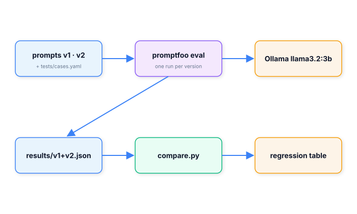
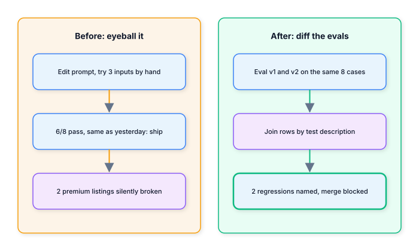

# Lesson 9 — Catching Prompt Regressions When You Change a Prompt

*Module 1 · Lesson 9 · Day 9*

Notion's AI team runs prompt changes through an evaluation suite before they reach users, because a wording tweak that improves one answer routinely degrades another. This lesson makes one specific failure impossible: tightening a prompt's tone and silently shrinking the product descriptions that needed length.

## The trap

You open the prompt, add "be punchy," run `npx promptfoo eval`, and read the summary: 6 passed, 2 failed. Yesterday it also said 6 passed. You ship. What the summary hid is that yesterday's two failures were the yoga mat and the backpack, and today's are the espresso machine and the standing desk — the two premium listings that must clear 40 words. Same pass rate, four flipped cases. With eight tests you might catch it by reading every row. With fifty, the flip vanishes into a percentage, a merchant reports the stubby copy three weeks later, and every prompt edit after that ships on hope.



## The solution

Diff the runs, not the totals. Evaluate v1 and v2 separately against the same test file, save each run to its own JSON, and join the rows on test-case name. Every case lands in exactly one bucket: regression (pass to fail), fix (fail to pass), drift (both pass, but the output was rewritten), or stable. The regression count is a number CI can gate on, and the names tell you exactly where to look.

The insight that takes months of production use to learn is the join key. Pairing rows by position works until someone inserts a case in the middle of the YAML; every row after it then compares the espresso machine against the backpack and reports garbage. Pair on `description` and treat descriptions as stable, unique slugs. The second insight: pass/fail is half the signal. Two outputs can clear every assertion while one has thrown the copy away entirely, so the comparison scores word-sequence similarity with Python's `difflib` and flags anything below 0.55 as drift — no model, no extra dependency.

## Build it

1. Create the baseline prompt at `prompts/v1.txt`.

```text
You are a copywriter for an online store.
Write a product description for "{{product_name}}" aimed at {{audience}}.
Key features: {{features}}.
Requirements:
- Mention the exact product name "{{product_name}}" at least once.
- Cover at least two of the key features.
- Write between 50 and 80 words in a single paragraph.
- Return only the description text, with no title, quotes, or preamble.
```

2. Create the "improved" prompt at `prompts/v2.txt`. This is the regression: its brevity rule fights the 40-word floor on premium products.

```text
You are a copywriter for an online store. Readers skim, so be punchy.
Write a product description for "{{product_name}}" aimed at {{audience}}.
Key features: {{features}}.
Requirements:
- Mention the exact product name "{{product_name}}" at least once.
- Cover at least two of the key features.
- Keep it under 30 words. Cut every word that does not sell.
- Return only the description text, with no title, quotes, or preamble.
```

3. Define eight named cases in `tests/cases.yaml`. Premium products carry `min_words: 40`; standard ones carry 15.

```yaml
# Each description is the join key compare.py uses to pair v1 and v2 rows — keep them unique and stable.
- description: standard-wireless-earbuds
  vars:
    product_name: Echo Buds Air
    audience: daily commuters
    features: active noise cancelling | 30-hour battery | sweat resistant
    keywords: noise|battery|sweat        # substrings the coverage assertion looks for
    min_words: 15
- description: standard-yoga-mat
  vars:
    product_name: Grounded Yoga Mat
    audience: beginner yogis
    features: non-slip surface | 6 mm cushioning | carry strap
    keywords: slip|cushion|strap
    min_words: 15
- description: standard-water-bottle
  vars:
    product_name: Trailhead Bottle
    audience: hikers
    features: double-wall insulation | leakproof lid | cold for 24 hours
    keywords: insulat|leak|cold
    min_words: 15
- description: standard-desk-lamp
  vars:
    product_name: Lumen Arc Lamp
    audience: remote workers
    features: glare-free LEDs | five brightness levels | USB-C charging port
    keywords: glare|bright|usb
    min_words: 15
- description: standard-backpack
  vars:
    product_name: Transit 22L Backpack
    audience: university students
    features: padded laptop sleeve | water-resistant fabric | hidden passport pocket
    keywords: laptop|water|pocket
    min_words: 15
- description: standard-phone-stand
  vars:
    product_name: PivotGrip Stand
    audience: people on video calls
    features: 360-degree rotation | aluminium build | folds flat
    keywords: rotat|alumin|fold
    min_words: 15
- description: premium-espresso-machine
  vars:
    product_name: Barista Pro 900
    audience: home baristas
    features: 15-bar Italian pump | PID temperature control | built-in burr grinder | steam wand
    keywords: pump|temperature|grinder|steam
    min_words: 40                        # premium listings need room to justify the price
- description: premium-standing-desk
  vars:
    product_name: Ascend Standing Desk
    audience: people who work from home
    features: dual motors | four memory presets | anti-collision sensor | bamboo top
    keywords: motor|preset|collision|bamboo
    min_words: 40
```

4. Write `promptfooconfig.yaml`. Both prompts are listed so a combined run renders side by side; the regression script overrides them one at a time.

```yaml
# yaml-language-server: $schema=https://promptfoo.dev/config-schema.json
description: "L9 product-description prompt regression"
prompts:
  - id: file://prompts/v1.txt
    label: v1                     # column header in the web UI
  - id: file://prompts/v2.txt
    label: v2
providers:
  - id: ollama:chat:llama3.2:3b   # local model, no API key
    config:
      temperature: 0              # remove sampling noise so diffs reflect the prompt
      seed: 42                    # pin the sampler for repeatable runs
defaultTest:
  assert:
    - type: icontains
      value: "{{product_name}}"
      metric: names_product
    - type: javascript
      metric: min_words
      value: |
        const n = output.trim().split(/\s+/).length;
        const min = Number(context.vars.min_words);
        return { pass: n >= min, score: n >= min ? 1 : 0, reason: `word count ${n} vs min ${min}` };
    - type: javascript
      metric: max_words
      value: |
        const n = output.trim().split(/\s+/).length;
        return { pass: n <= 120, score: n <= 120 ? 1 : 0, reason: `word count ${n} vs max 120` };
    - type: javascript
      metric: covers_features
      value: |
        const keys = String(context.vars.keywords).split('|');
        const hits = keys.filter((k) => output.toLowerCase().includes(k.trim().toLowerCase()));
        return { pass: hits.length >= 1, score: hits.length / keys.length, reason: `mentions ${hits.length}/${keys.length} feature keywords` };
tests: file://tests/cases.yaml
```

5. Write `scripts/compare.py`, the diff engine.

```python
#!/usr/bin/env python3
"""Diff two promptfoo result files and report regressions, fixes, and output drift."""
from __future__ import annotations

import argparse
import difflib
import json
import re
import sys
from dataclasses import asdict, dataclass
from pathlib import Path
from typing import Any

DRIFT_THRESHOLD = 0.55  # word-sequence similarity below this counts as a significant rewrite
ORDER = ["REGRESSION", "FIX", "DRIFT", "STILL_FAILING", "ADDED", "REMOVED", "STABLE"]
TOKEN = re.compile(r"[a-z0-9][a-z0-9'-]*")


@dataclass(frozen=True)
class CaseResult:
    """One test case's outcome under one prompt version."""

    name: str
    passed: bool
    output: str
    reason: str


@dataclass(frozen=True)
class CaseDiff:
    """How one test case changed between the baseline and candidate runs."""

    name: str
    status: str
    old_words: int
    new_words: int
    similarity: float
    reason: str


def extract_rows(data: Any) -> list[dict[str, Any]]:
    """Return per-test result rows from either promptfoo output layout."""
    rows: Any = data.get("results", data) if isinstance(data, dict) else data
    if isinstance(rows, dict):
        rows = rows.get("results", [])
    if not isinstance(rows, list):
        raise ValueError("no results list found in promptfoo output")
    return [row for row in rows if isinstance(row, dict)]


def case_name(row: dict[str, Any]) -> str:
    """Return the test description, falling back to the serialised vars."""
    test_case = row.get("testCase") or {}
    name = test_case.get("description") or row.get("description")
    if name:
        return str(name)
    return json.dumps(row.get("vars") or test_case.get("vars") or {}, sort_keys=True)


def output_text(row: dict[str, Any]) -> str:
    """Return the model output of a row as plain text."""
    output = (row.get("response") or {}).get("output", "")
    return output if isinstance(output, str) else json.dumps(output)


def row_passed(row: dict[str, Any]) -> bool:
    """Return whether every assertion on the row passed."""
    grading = row.get("gradingResult") or {}
    return bool(row.get("success", grading.get("pass", False)))


def failure_reason(row: dict[str, Any]) -> str:
    """Return the first failing assertion's reason, or an empty string when the row passed."""
    if row_passed(row):
        return ""
    grading = row.get("gradingResult") or {}
    for component in grading.get("componentResults") or []:
        if not component.get("pass", True):
            return str(component.get("reason") or "assertion failed")
    return str(grading.get("reason") or row.get("error") or "failed")


def load_results(path: Path) -> dict[str, CaseResult]:
    """Load a promptfoo result file into a map of case name to outcome."""
    data = json.loads(path.read_text(encoding="utf-8"))
    cases: dict[str, CaseResult] = {}
    for row in extract_rows(data):
        name = case_name(row)
        if name in cases:
            print(f"warning: duplicate case '{name}' in {path}; give every test a unique description", file=sys.stderr)
        cases[name] = CaseResult(name, row_passed(row), output_text(row), failure_reason(row))
    return cases


def word_count(text: str) -> int:
    """Count whitespace-separated words the same way the promptfoo assertion does."""
    return len(text.split())


def similarity(old: str, new: str) -> float:
    """Return a 0-1 word-sequence similarity between two outputs."""
    matcher = difflib.SequenceMatcher(None, TOKEN.findall(old.lower()), TOKEN.findall(new.lower()), autojunk=False)
    return round(matcher.ratio(), 2)


def classify(name: str, old: CaseResult | None, new: CaseResult | None, threshold: float) -> CaseDiff:
    """Place one case into exactly one status bucket."""
    if old is None or new is None:
        if new is not None:
            return CaseDiff(name, "ADDED", 0, word_count(new.output), 0.0, "only in the new run")
        if old is not None:
            return CaseDiff(name, "REMOVED", word_count(old.output), 0, 0.0, "only in the old run")
        raise ValueError(f"case '{name}' is missing from both runs")
    score = similarity(old.output, new.output)
    if old.passed and not new.passed:
        status, reason = "REGRESSION", new.reason
    elif new.passed and not old.passed:
        status, reason = "FIX", f"was: {old.reason}"
    elif not new.passed:
        status, reason = "STILL_FAILING", new.reason
    elif score < threshold:
        status, reason = "DRIFT", f"both pass, similarity {score:.2f} < {threshold:.2f}"
    else:
        status, reason = "STABLE", ""
    return CaseDiff(name, status, word_count(old.output), word_count(new.output), score, reason)


def compare(old: dict[str, CaseResult], new: dict[str, CaseResult], threshold: float) -> list[CaseDiff]:
    """Pair cases by name across both runs and classify every pair."""
    diffs = [classify(name, old.get(name), new.get(name), threshold) for name in set(old) | set(new)]
    return sorted(diffs, key=lambda diff: (ORDER.index(diff.status), diff.name))


def count_statuses(diffs: list[CaseDiff]) -> dict[str, int]:
    """Count how many cases landed in each status bucket."""
    counts = {status: 0 for status in ORDER}
    for diff in diffs:
        counts[diff.status] += 1
    return counts


def render_table(diffs: list[CaseDiff]) -> str:
    """Render the diffs as a fixed-width terminal table."""
    width = max([len(diff.name) for diff in diffs] + [len("TEST CASE")]) + 2
    header = f"{'STATUS':<15}{'TEST CASE':<{width}}{'WORDS':>9}{'SIM':>7}  DETAIL"
    lines = [header, "-" * (len(header) + 30)]
    for diff in diffs:
        words = f"{diff.old_words}->{diff.new_words}"
        lines.append(f"{diff.status:<15}{diff.name:<{width}}{words:>9}{diff.similarity:>7.2f}  {diff.reason[:70]}")
    return "\n".join(lines)


def summary_line(diffs: list[CaseDiff], counts: dict[str, int]) -> str:
    """Build the headline verdict naming every regressed case."""
    regressions = [diff.name for diff in diffs if diff.status == "REGRESSION"]
    tail = (
        f"fixes: {counts['FIX']} · drifted: {counts['DRIFT']} · "
        f"still failing: {counts['STILL_FAILING']} · stable: {counts['STABLE']}"
    )
    if not regressions:
        return f"✅ 0 regressions introduced\n   {tail}"
    noun = "regression" if len(regressions) == 1 else "regressions"
    return f"❌ {len(regressions)} {noun} introduced: {', '.join(regressions)}\n   {tail}"


def write_reports(diffs: list[CaseDiff], counts: dict[str, int], old_path: Path, new_path: Path, out_dir: Path, threshold: float) -> tuple[Path, Path]:
    """Write diff.json and diff.md into the output directory and return their paths."""
    out_dir.mkdir(parents=True, exist_ok=True)
    json_path = out_dir / "diff.json"
    md_path = out_dir / "diff.md"
    payload = {
        "old": str(old_path),
        "new": str(new_path),
        "threshold": threshold,
        "counts": counts,
        "cases": [asdict(diff) for diff in diffs],
    }
    json_path.write_text(json.dumps(payload, indent=2, ensure_ascii=False) + "\n", encoding="utf-8")
    rows = [
        f"| {d.status} | {d.name} | {d.old_words} → {d.new_words} | {d.similarity:.2f} | {d.reason.replace('|', '/')} |"
        for d in diffs
    ]
    markdown = [
        f"# Prompt diff: {old_path.name} → {new_path.name}",
        "",
        "| Status | Test case | Words | Similarity | Detail |",
        "|---|---|---|---|---|",
        *rows,
        "",
    ]
    md_path.write_text("\n".join(markdown), encoding="utf-8")
    return json_path, md_path


def main(argv: list[str] | None = None) -> int:
    """Parse arguments, run the comparison, write reports, and return an exit code."""
    parser = argparse.ArgumentParser(description=__doc__)
    parser.add_argument("old", type=Path, help="baseline result file, e.g. results/v1.json")
    parser.add_argument("new", type=Path, help="candidate result file, e.g. results/v2.json")
    parser.add_argument("--out", type=Path, default=Path("reports"), help="directory for diff.json and diff.md")
    parser.add_argument("--threshold", type=float, default=DRIFT_THRESHOLD, help="similarity below this counts as drift")
    parser.add_argument("--no-fail", action="store_true", help="exit 0 even when regressions exist")
    args = parser.parse_args(argv)

    diffs = compare(load_results(args.old), load_results(args.new), args.threshold)
    counts = count_statuses(diffs)
    print(f"Comparing {args.old} -> {args.new}  (drift threshold {args.threshold:.2f})\n")
    print(render_table(diffs))
    print()
    print(summary_line(diffs, counts))
    json_path, md_path = write_reports(diffs, counts, args.old, args.new, args.out, args.threshold)
    print(f"   reports: {json_path}, {md_path}")
    return 1 if counts["REGRESSION"] and not args.no_fail else 0


if __name__ == "__main__":
    sys.exit(main())
```

6. Write `scripts/run_regression.sh` to evaluate each version and run the comparison.

```bash
#!/usr/bin/env bash
# Evaluate prompts/v1.txt and prompts/v2.txt separately, then diff the two runs.
set -euo pipefail

cd "$(dirname "$0")/.."
PROMPTFOO="${PROMPTFOO:-npx --yes promptfoo@latest}"
OLLAMA_URL="${OLLAMA_BASE_URL:-http://localhost:11434}"
export PROMPTFOO_DISABLE_TELEMETRY=1
mkdir -p results reports

tags="$(curl -sf "${OLLAMA_URL}/api/tags" || true)"
if ! grep -q 'llama3.2:3b' <<<"${tags}"; then
  echo "Ollama at ${OLLAMA_URL} has no llama3.2:3b — run: ollama pull llama3.2:3b" >&2
  exit 2
fi

evaluate() {
  local version="$1"
  local status=0
  echo "▶ promptfoo eval  prompts/${version}.txt  ->  results/${version}.json"
  # --no-cache: the cache key ignores model weights, so a cached baseline can predate your last `ollama pull`.
  ${PROMPTFOO} eval \
    -c promptfooconfig.yaml \
    --prompts "prompts/${version}.txt" \
    --output "results/${version}.json" \
    --description "L9 ${version}" \
    --no-cache || status=$?
  # promptfoo exits 100 when assertions fail; anything else means the run itself broke.
  if [[ ${status} -ne 0 && ${status} -ne 100 ]]; then
    echo "promptfoo crashed on ${version} (exit ${status})" >&2
    exit "${status}"
  fi
  if [[ ! -s "results/${version}.json" ]]; then
    echo "results/${version}.json was not written" >&2
    exit 1
  fi
}

evaluate v1
evaluate v2

echo
python3 scripts/compare.py results/v1.json results/v2.json --out reports
```

7. Run the regression check.

```bash
chmod +x scripts/run_regression.sh && ./scripts/run_regression.sh
```

```text
STATUS         TEST CASE                     WORDS    SIM  DETAIL
REGRESSION     premium-espresso-machine     58->22   0.18  word count 22 vs min 40
REGRESSION     premium-standing-desk        61->19   0.21  word count 19 vs min 40
DRIFT          standard-desk-lamp           57->21   0.24  both pass, similarity 0.24 < 0.55
...
❌ 2 regressions introduced: premium-espresso-machine, premium-standing-desk
```

8. Run the combined eval and open the side-by-side view.

```bash
npx --yes promptfoo@latest eval -c promptfooconfig.yaml; npx --yes promptfoo@latest view --yes
```



## Proof it works

- `./scripts/run_regression.sh` ends with `❌ 2 regressions introduced: premium-espresso-machine, premium-standing-desk`, and `echo $?` prints `1`.
- `reports/diff.json` exists with `"REGRESSION": 2` under `counts`, and both regression entries carry a `reason` that starts with `word count` and ends with `vs min 40`.
- `http://localhost:15500` opens the eval table with `v1` and `v2` as adjacent columns; both premium rows are green under v1 and red under v2.

## The non-obvious thing

promptfoo caches every response, keyed on the prompt text and provider config — not on the model weights. Run `ollama pull llama3.2:3b` after an update and a cached v1 baseline keeps replaying last month's outputs, while v2, being new text, hits the new weights. You end up blaming the prompt for a model change. That is why `run_regression.sh` passes `--no-cache`: both versions must answer from the same weights in the same run, or the diff measures nothing.

## What's next

Word counts and substring checks caught this regression because it was about length. They cannot tell you whether v2's description still says what a shopper needs; Lesson 10 moves evaluation into pytest with DeepEval, where metrics score meaning instead of characters.

## Homework

1. Evaluate v1 twice with `--no-cache` into `results/v1a.json` and `results/v1b.json`, compare them into `reports/noise/`, and record the DRIFT count.
2. Repeat the double run with `-j 1` and record the DRIFT count again.
3. Write `prompts/v3.txt` so that `compare.py results/v1.json results/v3.json` prints `✅ 0 regressions introduced`.
4. Add a `--max-drift N` flag to `compare.py`, with a pytest test proving it exits 1 when drift exceeds N.

Solution path: give the prompt a length budget it can read. Add a `length_hint` variable to each case and reference it in v3; the homework artifact walks through the rest.
